# Shinobi .NET Studio

**A Visual Studio-style workflow in VS Code and VSCodium: a Visual Studio-style Solution Explorer, NuGet Package Manager, Error List, Test Explorer, project templates and Publish.** For .NET developers who want to leave Visual Studio (and Windows) behind without relearning their daily work: the same tree, the same context menus, and Visual Studio's keys where they do not clash with VS Code's.

**Why:** free and MIT licensed, no C# Dev Kit needed, and it runs in VS Code and VSCodium (any Open VSX editor that has a C# extension).

## Install

VS Code: search for "Shinobi .NET Studio" in the Extensions view, or `code --install-extension shinobi.dotnet-studio --pre-release`.
VSCodium and other Open VSX editors: the same search, or `codium --install-extension shinobi.dotnet-studio --pre-release`.

Until the first stable release this is a pre-release: in the Extensions view choose **Install Pre-Release Version**.

A C# extension is needed for editing and debugging, see [Requirements](#requirements).

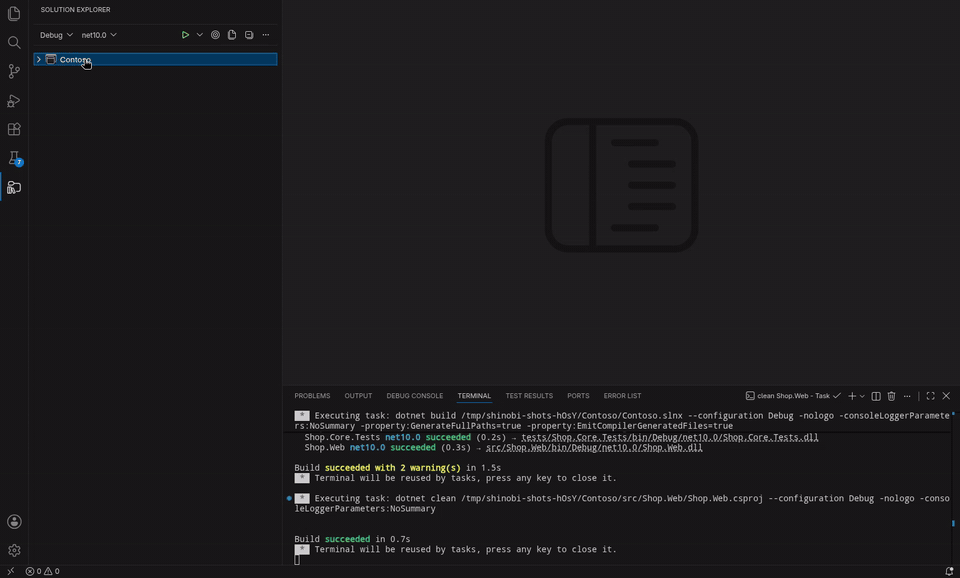

## Features

### Solution Explorer

`.sln` and `.slnx` solutions as Visual Studio shows them: solution folders and items, projects with Dependencies, Visual Studio's file nesting (`Index.cshtml` › `Index.cshtml.cs`) and your file icon theme. Errors and warnings show on files, folders and projects. Set the startup project, rename, cut/copy/paste, drag and drop, multi-select, Sync with Active Document, type to find. The tree shows the project's items: Show All Files greys out what a project does not contain, Exclude From Project and Include In Project take files and folders out and put them back, and linked files appear with a link badge.

Right-click anything for Visual Studio's commands: Build, Rebuild, Clean, Add New Item, Add Existing Item, Add Project Reference, Manage NuGet Packages, Manage User Secrets, Open in Terminal, Edit Project File, and more.

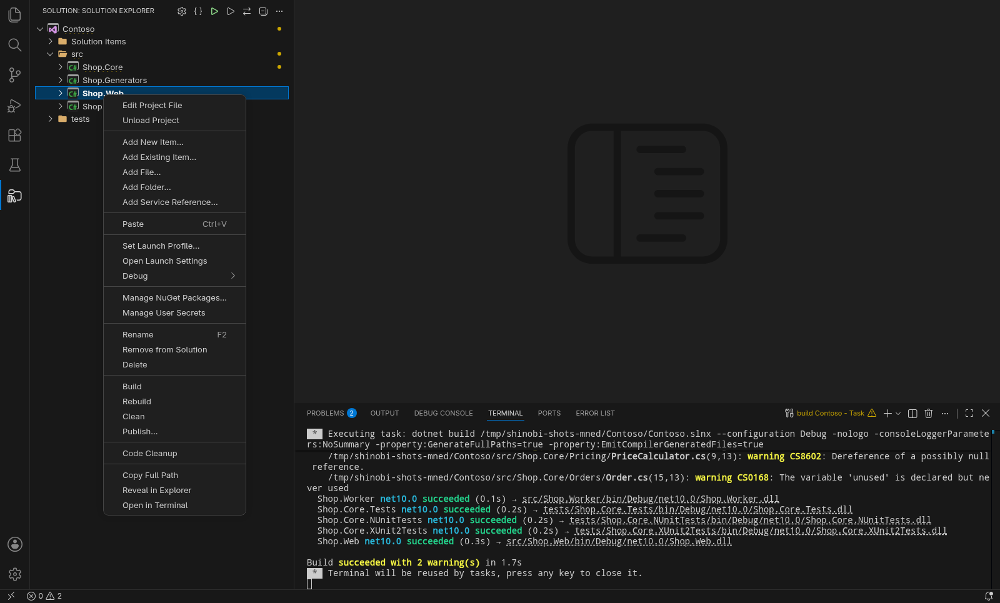

[Solution Explorer](docs/solution-explorer.md) · [Context menus](docs/context-menus.md) · [Keyboard shortcuts](docs/keyboard-shortcuts.md)

### Dependencies, source generators and transitive packages

Packages expand into the packages they bring in, levels deep. Analyzers list the source generators of a project and the files they generated, which open read-only.

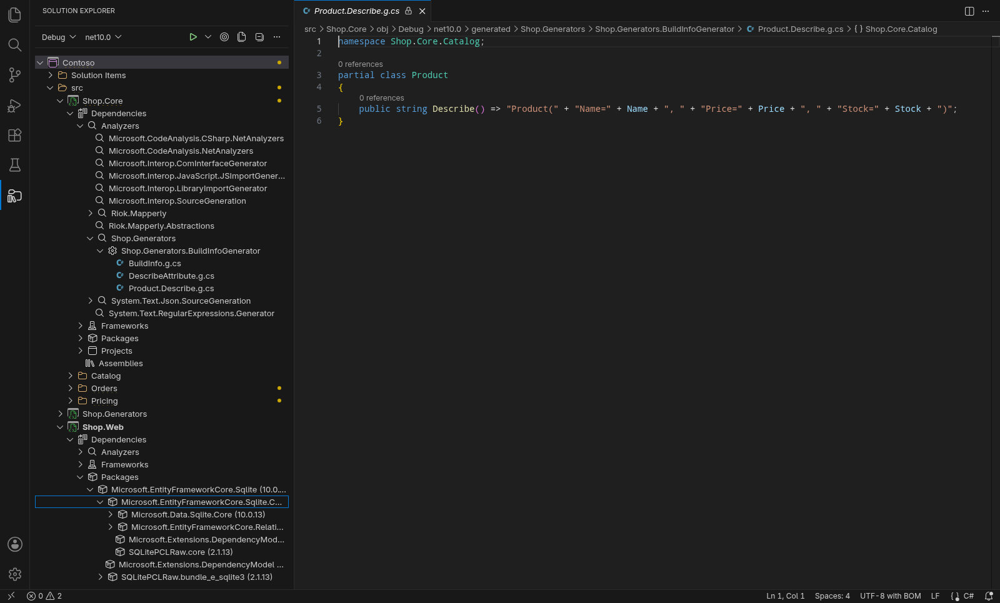

### Error List

An Error List like Visual Studio's: a sortable, filterable table of errors, warnings and messages from builds and the language server, with column filters and links to each code's documentation. Ctrl+Shift+B builds the solution.

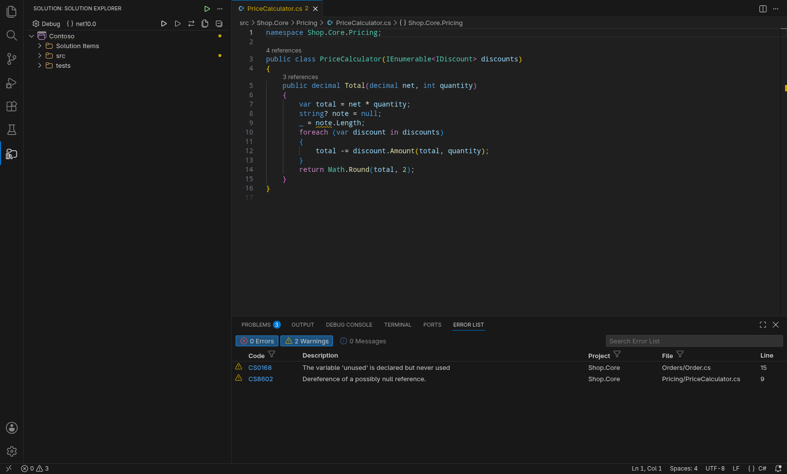

[Error List](docs/error-list.md)

### Tests

xUnit, NUnit, MSTest and TUnit, on Microsoft.Testing.Platform or VSTest, in VS Code's Testing view: run and debug single tests, classes or projects, from the editor gutter or with Run Tests / Debug Tests in the Solution Explorer. Failures show the message, expected and actual values, and the stack trace.

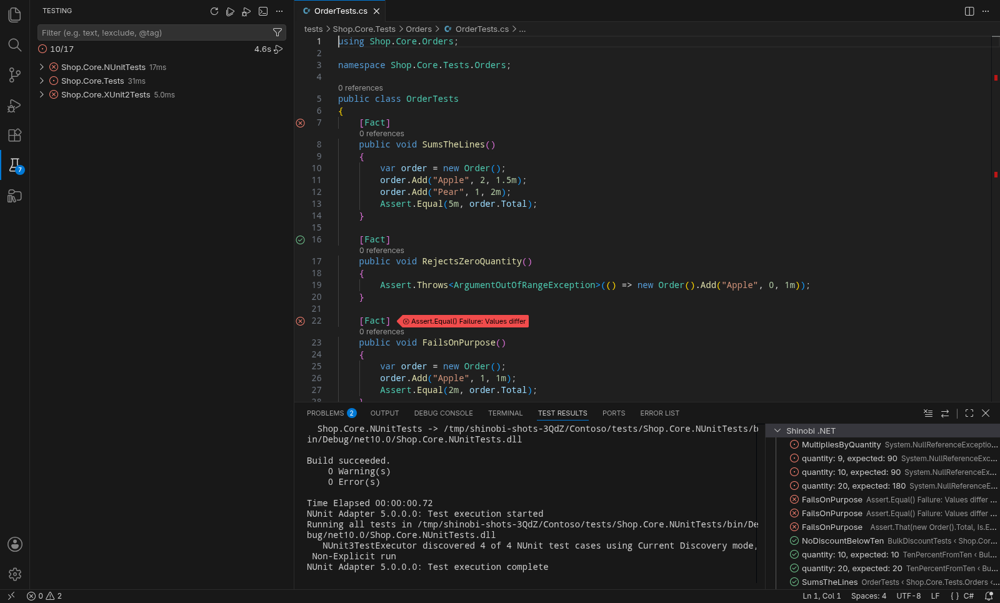

[Tests](docs/tests.md)

### NuGet Package Manager

Browse, Installed (with transitive packages), Updates and Consolidate, per project or for the whole solution, also with Central Package Management (`Directory.Packages.props`, overrides and global packages). Private feeds work; when a token expires, it says which feed and where its credentials are, and takes a new one.

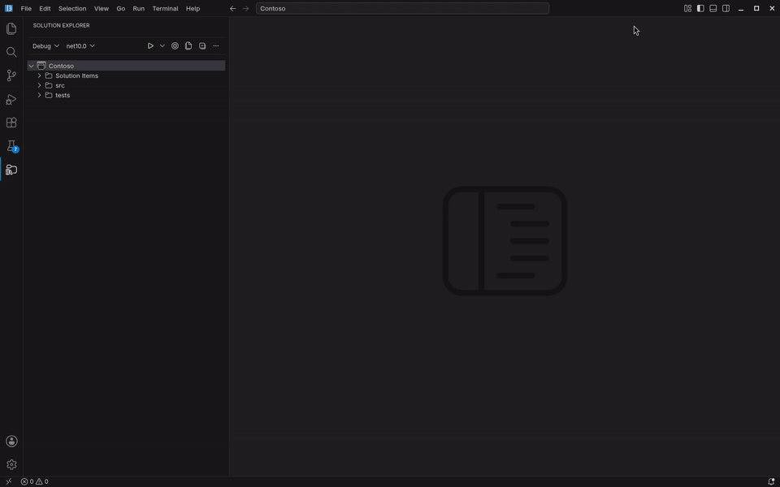

[NuGet](docs/nuget.md)

### New projects and items

Add New Project and Add New Item wizards like Visual Studio's, with every `dotnet new` template and its settings. In an empty folder, Create New Project starts a solution.

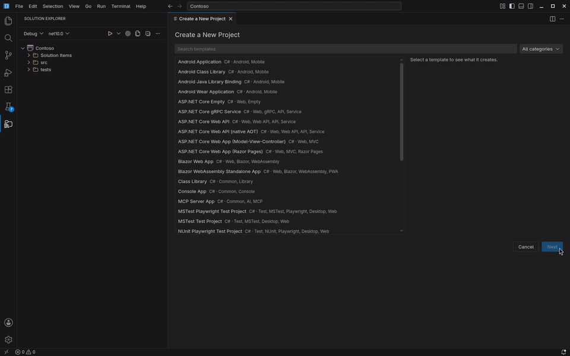

[Templates](docs/templates.md)

### Run & Debug

Set as Startup Project with its launch profiles, Open Launch Settings (creates `launchSettings.json` when there is none), F5, Ctrl+F5, Debug > Start New Instance, Debug/Release. The browser opens when the web app is ready.

Several startup projects work like Visual Studio's "Multiple startup projects": right-click the solution > Configure Startup Projects..., choose which projects start (with or without the debugger), their launch profile and order, and F5 starts them all. The profiles are stored in a `.slnLaunch` file next to the solution, the one Visual Studio reads, so a team shares them.

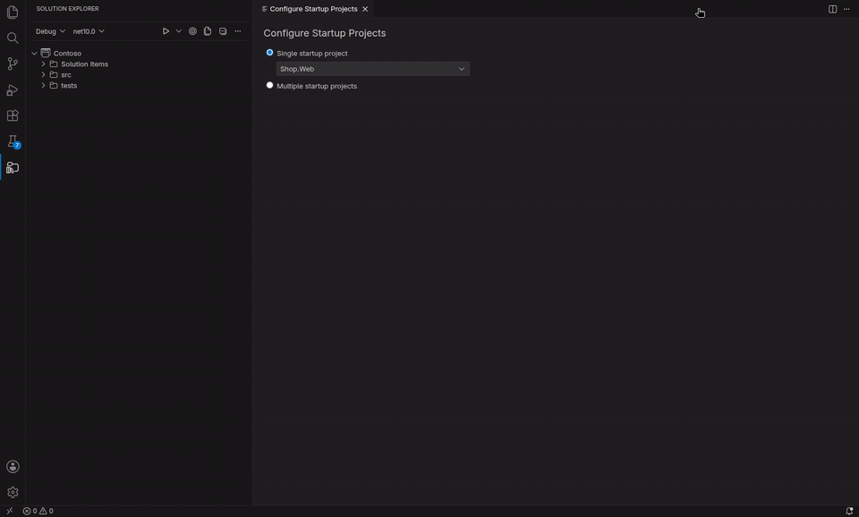

Attach to Process (command palette) lists the running .NET programs with their project and ports and attaches the debugger to the one you pick.

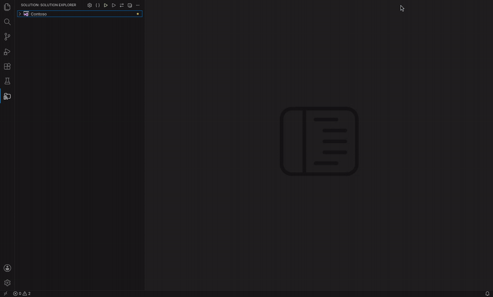

Starting a project with an `https://` launch profile checks once whether the HTTPS development certificate is trusted and offers to trust it (also in the command palette: Trust HTTPS Development Certificate).

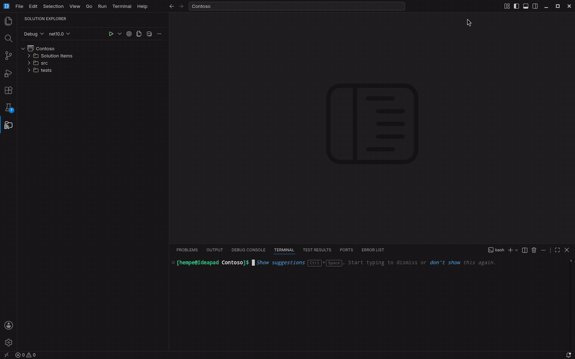

Debug > Start with Hot Reload runs a project with `dotnet watch`: saved code changes apply to the running app (without the debugger).

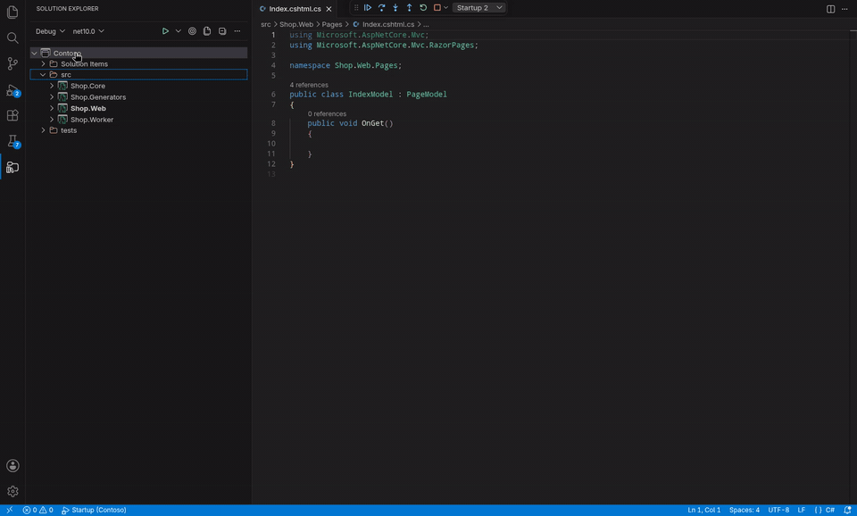

[Run & Debug](docs/run-and-debug.md)

### Configuration Manager

A Configuration Manager like Visual Studio's (Build > Configuration Manager): add, rename and remove the solution's configurations and platforms (Debug/Release, Any CPU/x64), pick the active pair, and set per project which configuration and platform it builds in and whether it builds at all. Right-click the solution > Configuration Manager.... The changes go straight into the `.sln` or `.slnx`.

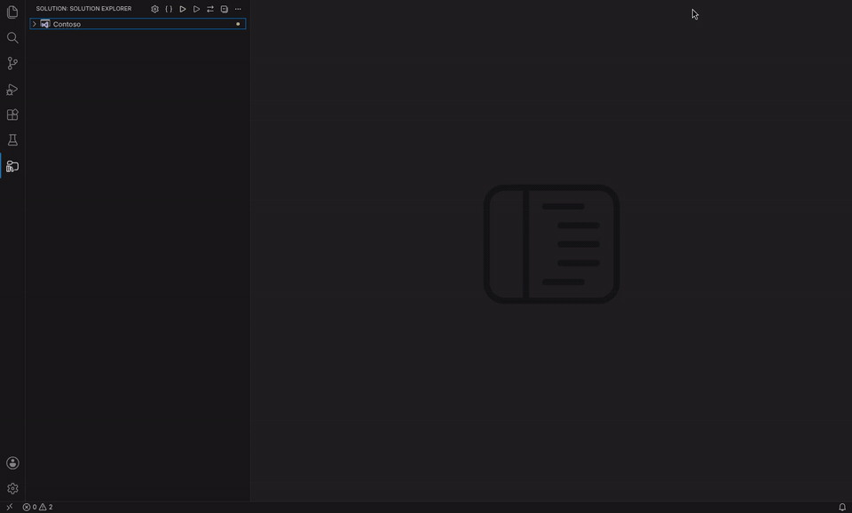

[Configuration Manager](docs/configuration-manager.md)

### Code Cleanup

Code Cleanup like Visual Studio's (Analyze > Code Cleanup): formatting, unused usings and the code style fixes your `.editorconfig` asks for, on a file, folder, project or the whole solution, with progress and Cancel. Right-click a node > Code Cleanup, or press Ctrl+K, Ctrl+E in a C# file. It runs `dotnet format`, so the result matches your pipeline.

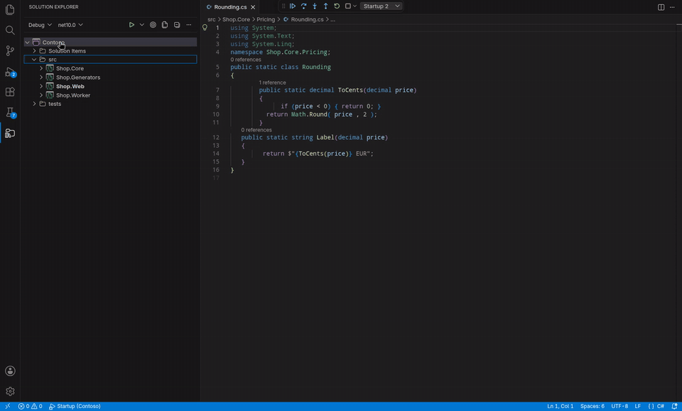

[Code Cleanup](docs/code-cleanup.md)

### Sync Namespaces

Sync Namespaces like Visual Studio's: right-click a project or folder > Sync Namespaces changes the namespaces of its C# files to match the root namespace and the folders, and the C# language server updates the references in other files. It asks first, shows progress with Cancel and ends with a summary. Needs a C# extension and IDE0130 reporting in your `.editorconfig`.

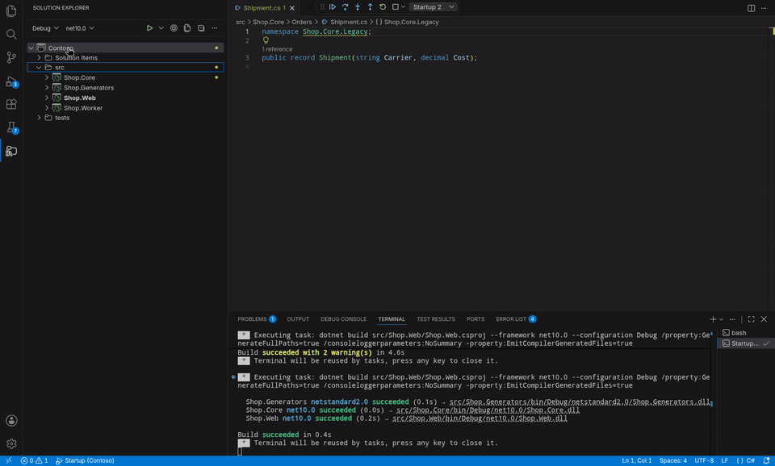

[Sync Namespaces](docs/sync-namespaces.md)

### Publish

A Publish tab like Visual Studio's for folder publishing, with the same `.pubxml` profiles, so teammates on Visual Studio see the same ones.

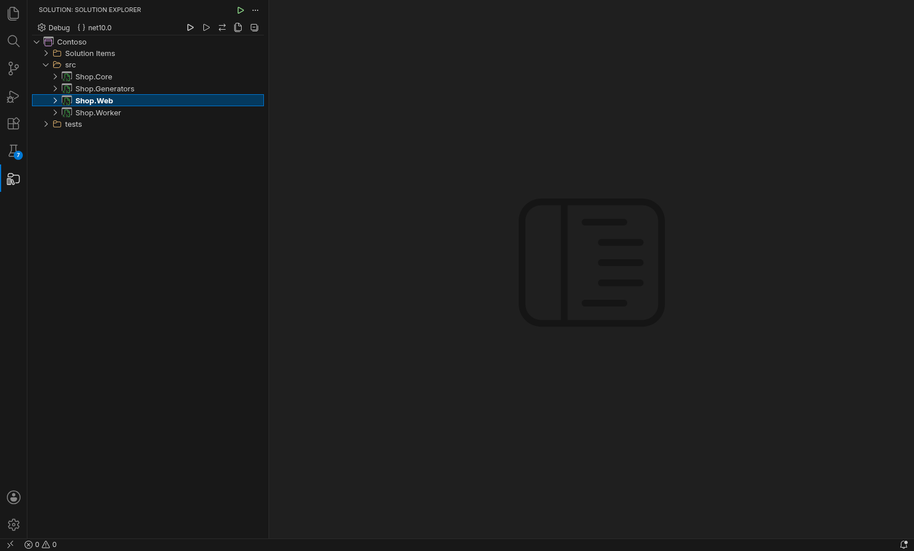

[Publish](docs/publish.md)

### Connected Services

Add, update and remove WCF/SOAP service references, compatible with the ones Visual Studio made, and gRPC references from `.proto` files or URLs (client, server or both, with the packages).

[Connected Services](docs/connected-services.md)

## Requirements

- VS Code 1.106 or later, or VSCodium or another Open VSX editor
- The .NET SDK 8.0 or later; `.slnx` solutions need 9.0.200 or later
- Linux and Windows are tested (the test suite runs on both in CI); macOS should work but is not tested
- A C# extension, for editing C# and debugging: [C#](https://marketplace.visualstudio.com/items?itemName=ms-dotnettools.csharp) (`ms-dotnettools.csharp`) in VS Code, or [its open source fork](https://open-vsx.org/extension/muhammad-sammy/csharp) (`muhammad-sammy.csharp`) in VSCodium. C# Dev Kit isn't needed.

## Getting started

1. Open a folder that contains a `.sln` or `.slnx` file (at the top or a few folders down). The **Solution Explorer** appears in the activity bar (Ctrl+Alt+L).
2. Right-click a web or console project > **Set as Startup Project**, then press **F5**.
3. No solution yet? Run **.NET: Create New Project...** from the command palette.

More: [Getting started](docs/README.md#getting-started) · [Troubleshooting](docs/troubleshooting.md)

## Coming from Visual Studio

Most things are where you expect them. The differences, in short:
- the C# editing and the debugger come from the C# extension;
- the startup project is stored in `.vscode/launch.json`;
- errors and generated code are as of the last build.

The [Visual Studio comparison](docs/visual-studio-comparison.md) lists what is supported, what works differently and what is not planned, and where the keys differ.

## Settings

File nesting, Track Active Item, where the Solution Explorer sits, which diagnostics show, test discovery and more: [Settings](docs/settings.md).

## Privacy

The extension sends no telemetry. Its network use is the NuGet Package Manager, which talks to the package sources in your `NuGet.Config` (nuget.org by default, and private feeds with the credentials you configured there) to search, show details and update packages, and the gRPC references, which download `.proto` files from the URL you enter and look up package versions in the same sources. The first .NET Framework test run under Mono downloads Microsoft's test platform package through `dotnet restore`. Everything else runs the `dotnet` command on your machine; the .NET SDK has its own telemetry settings (`DOTNET_CLI_TELEMETRY_OPTOUT`).

## Issues and development

Found a bug or miss something from Visual Studio? [Open an issue](https://github.com/hempe/vscode-dot-studio/issues). [Troubleshooting](docs/troubleshooting.md) lists known limitations. To build, run or change the extension, see [DEVELOPER.md](DEVELOPER.md).

## License

[MIT](LICENCE.md)

Shinobi .NET Studio is an independent project. It is not affiliated with, endorsed by or sponsored by Microsoft. Visual Studio, Visual Studio Code and .NET are trademarks of Microsoft Corporation, mentioned here only to say what this extension is modelled on.
