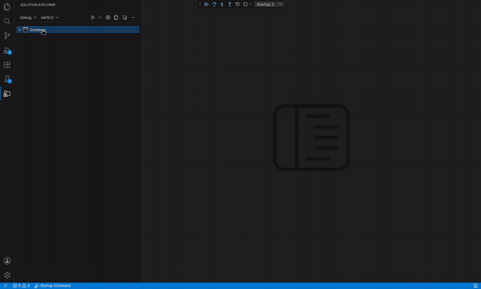

# NuGet

Visual Studio's NuGet Package Manager, in an editor tab.

- Right-click a **project** (or its Dependencies / Packages node) > **Manage NuGet Packages...**: packages of that project.
- Right-click the **solution** > **Manage NuGet Packages...**: packages of all projects, with the Consolidate tab.

## Tabs

| Tab | |
|---|---|
| **Browse** | Search the package feeds; pick a version and the projects, then Install |
| **Installed** | **Top-level packages** the projects reference, and a collapsible **Transitive packages** section: packages they only get through other packages, each with what brings it in ("Transitively referenced by ...") |
| **Updates** | Packages with newer versions; update one, or check several and **Update Selected** |
| **Consolidate** | (solution only) Packages used in different versions across projects, to bring them to one version |

**Package source** (Browse) is a dropdown like Visual Studio's: **All** (the enabled sources of your `NuGet.Config`) or one source by name, for example `nuget.org` or a private feed. Choosing one searches again. **Refresh** (the button right of Include prerelease, on every tab) drops the cached answers of the feeds and reads the lists again, and searches again in Browse: use it after publishing a package or when a feed was unreachable. **Include prerelease** adds prerelease versions. The details pane shows the description, versions, dependencies and the package's README.

**Transitive packages:** Install makes one a direct reference, e.g. to pin a newer version with a security fix; they have no Uninstall, since only the package that brings them in can be removed. Solution Explorer: [Dependencies > Packages](solution-explorer.md#dependencies) shows the same tree under each package.

## Vulnerable and deprecated packages

The Installed and Updates lists label the versions you use that have a known vulnerability (**vulnerable: high**, with the worst severity: critical, high, moderate or low) or that the author deprecated (**deprecated**). The details pane names each advisory with its link (GitHub Advisory Database), and for a deprecated package the reasons and the package to use instead. In **Installed**, the **Vulnerable** and **Deprecated** checkboxes show only those packages (both checked: either). Transitive packages are checked too, so a vulnerable package you only get through another one shows in its section, and **Install** on it pins a newer version.

The labels come from `dotnet list package --vulnerable` and `--deprecated`, which ask your feeds (private feeds that publish vulnerability data included, as NuGet Audit does on restore), so they appear a few seconds after the lists, once per refresh. They need a restored project and the feeds; without them the labels are missing, the lists work as before.

## Central Package Management

Solutions that keep their package versions in `Directory.Packages.props` (`ManagePackageVersionsCentrally`) work like the others: Installed, Updates and the Dependencies tree show the version MSBuild uses for each project, and where it comes from:

| Shown | Where the version is |
|---|---|
| `v3.1.1` | the `PackageVersion` in `Directory.Packages.props` (or a props file it imports) |
| `v13.0.2 (override)` | the project's own `VersionOverride` |
| `global` | a `GlobalPackageReference`: every project gets the package |

Packages from a `GlobalPackageReference` carry a **global** badge in the lists. The details pane says where the selected package's version is set: the props file, and in the solution's manager which projects use that central version and which override it. **Set for This Project Only** (under Install, when the selected projects take the version from `Directory.Packages.props` and have the `PackageReference` in their own project file) writes a `VersionOverride` with the chosen version instead of changing the central one, without asking. A `PackageReference` that comes from a props file such as `Directory.Build.props` has nothing in the project file to put a `VersionOverride` on, so the button is not offered for it.

A project that turns CPM off (`<ManagePackageVersionsCentrally>false</ManagePackageVersionsCentrally>`) keeps the versions in its project file, as before. When the .NET SDK cannot evaluate a project, its versions show as not known and are never offered as updates. A project that targets several frameworks is evaluated for its first target framework only: packages that only another framework uses are not shown, updated or counted. Updates of pinned transitive packages (`CentralPackageTransitivePinningEnabled`) are not offered; change them in `Directory.Packages.props`.

### What Install, Update and Uninstall change

The extension edits `Directory.Packages.props` itself (the `dotnet` CLI refuses imported props files and global packages), as text edits that keep your formatting and comments, in the file that defines the entry. New elements never go into an `ItemGroup` with a `Condition`. A `<PackageVersion Update="X" Version="..." />` in the same file gets the new version too, since MSBuild applies it over the `Include`.

**Versions written as a property** (`<PackageVersion Include="Serilog" Version="$(SerilogVersion)" />`): the property's definition is changed, so the package keeps following it; it is looked for in `Directory.Build.props`, `Directory.Packages.props` and the files they import (the last one MSBuild reads wins). When other packages use the same property, you are asked first: **Change SerilogVersion** (named with the packages that change along and the projects that use them) or **Set Serilog Only**, which writes the version on Serilog alone (it no longer follows the property; what `dotnet add package` always does). When the definition cannot be changed (not found, under a `Condition`, set again in a project file, or other packages of the same change want another version) only Set Serilog Only is offered. Updating all packages of a property to the same version (Update Selected) changes the property once, without a question.

The files of one change are written together: when one cannot be written, the others get their old content back.

| Action | What is written |
|---|---|
| **Install** a package the props file has no version for | `<PackageReference Include="X" />` in the project, `<PackageVersion Include="X" Version="..." />` in `Directory.Packages.props` (or, when that file holds no versions itself, in the imported props file that holds the most) |
| **Install** a global package the project opted out of | the project's `<GlobalPackageReference Remove="X" />` is removed again (also when every project opted out) |
| **Install** or **Update** to another version than the central one | the central `PackageVersion` (once, for every project that uses it) |
| **Set for this project only** | `VersionOverride="..."` on the project's `PackageReference`; the other projects keep the central version |
| **Update** a package the project overrides | its `VersionOverride`; set to the central version it is removed again |
| **Update** a global package | the `Version` of its `GlobalPackageReference` |
| **Uninstall** | the project's `PackageReference`; when no project of the solution uses the package any more you are asked whether to remove its `PackageVersion` too. You are not asked while a project of the solution targets several frameworks (only its first framework is evaluated, so another one may still use the package) or could not be evaluated |
| **Uninstall** a global package | the `GlobalPackageReference` (for every project), or, for the selected projects only, `<GlobalPackageReference Remove="X" />` in each project file |

**Before a change reaches other projects** (a central or global version used by projects you did not select), a confirmation lists them: **Update All Projects** changes the central version, **Set for This Project Only** writes a `VersionOverride` instead (not offered for global packages, for a `PackageReference` from a props file such as `Directory.Build.props`, or when `CentralPackageVersionOverrideEnabled` is `false`). Update Selected on the Updates tab asks once for all packages. Afterwards the solution is restored.

A `PackageReference` that comes from a props file (not the project file) cannot be uninstalled in the NuGet manager, since `dotnet remove package` does not find it; edit the props file.

Projects that do not use CPM in the same solution are changed with `dotnet add package` / `dotnet remove package`, as before.

### Consolidate

Under CPM the versions of a package differ only through `VersionOverride`s (or through two props files with different versions). Consolidate sets the central version (or the global one) to the chosen version and removes the overrides; a confirmation lists each change first. Projects in the same solution that do not use CPM are updated in their project files, as before.

After Consolidate or Update Selected, the Installed and Updates tabs show the new versions.

### Edits made outside the extension

Edits to `Directory.Packages.props`, to any file it imports (directly or through other imports, also one that only defines properties used as versions), or to another props file that defines package versions, made by hand or by `git checkout`, show in the tree and in open NuGet managers after a moment (the projects are evaluated again). Imports whose path depends on properties other than `$(MSBuildThisFileDirectory)` are not followed. A props file outside the opened folder is checked when you switch to the NuGet manager (the tree shows its changes after that, or after a project file changes). A props file that imports no package versions yet is not watched until it has one.

## Private feeds

Feeds and credentials come from `NuGet.Config`, found like NuGet finds them: every `NuGet.Config` from the solution folder up, then your user configuration. Credentials go in `<packageSourceCredentials>` with `Username` and `ClearTextPassword`; this works for Azure DevOps, GitHub Packages, GitLab, Artifactory, MyGet and others.

**The `.nuget` folder:** Visual Studio also reads a solution-level `.nuget/NuGet.Config` (the NuGet.exe-era location). `dotnet restore` and the other command line tools do **not**: for them only `nuget.config` in the solution folder (or above it) and the user config count, so a restore fails with `NU1101` for packages of a private feed that only that file names. The NuGet manager reads the `.nuget` file like Visual Studio (feeds and credentials), and the extension offers to fix the cause: when the solution opens, **Move** puts the file at `nuget.config` in the solution folder (the old file goes), **Copy** keeps both, **Not Now** asks again next time, **Don't Ask Again** turns it off for the solution (setting `shinobi.solution.offerNugetConfigMove`). After a failed restore or build the same question comes once per session. Scripts that point at the old path with `--configfile` need the new path after a move.

**When a feed rejects its credentials** (an expired token), a message says which feed, where its credentials are (file and line), what to do for that kind of feed, and offers **Enter New Token...**, which stores the new token as `ClearTextPassword`. It works without restarting.

**Not supported:** encrypted `Password` values. Visual Studio encrypts them with Windows DPAPI, which nothing outside Windows can read. Use `ClearTextPassword`, or the Azure Artifacts Credential Provider, which covers restore and build.

**Vulnerable packages:** restore reports packages with known vulnerabilities (NuGet Audit, NU1901-NU1904) as warnings in the [Error List](error-list.md).
