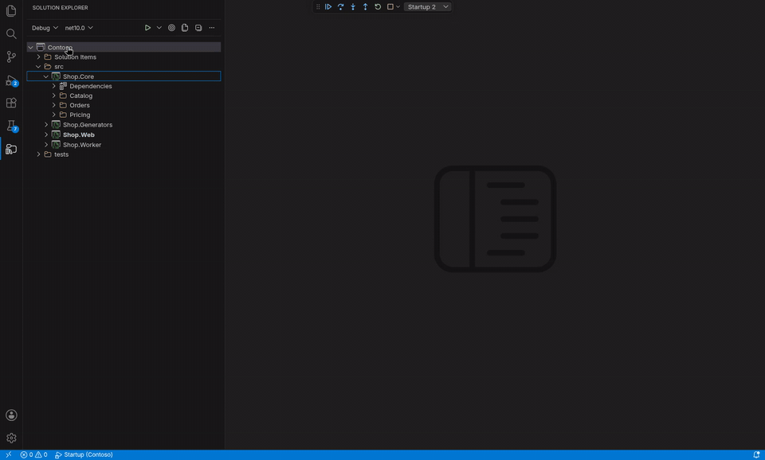
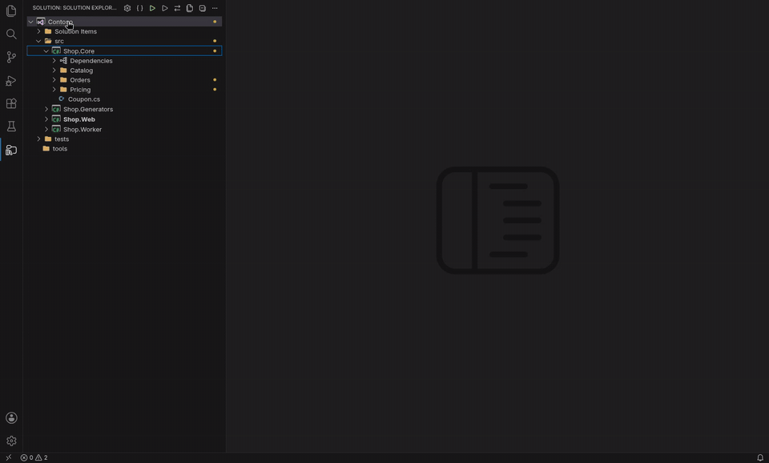

# Solution Explorer

The solution as Visual Studio shows it: solution folders, projects, their files and dependencies. It reads `.sln` and `.slnx` files and edits them when you add, remove or rename things.

## The tree

| Node | What it is |
|---|---|
| Solution | The `.sln` / `.slnx` file |
| Solution folder | A virtual folder in the solution file (not on disk); holds projects, other solution folders and solution items |
| Solution item | A file listed in a solution folder, e.g. a README or `Directory.Build.props` |
| Project | A `.csproj`, `.vbproj` or `.fsproj`. The **startup project** is shown in **bold** |
| Folder, file | What is in the project's folder. SDK-style projects include files by location, and so does the tree (`bin`, `obj` and similar are left out) |
| Dependencies | The project's references, see below |

Solution folders next to each other cannot share a name (upper and lower case count as the same, as MSBuild requires): Add and Rename Solution Folder say so. Remove Solution Folder removes everything in it, projects of every type included.

**File nesting** works like Visual Studio's: `Index.cshtml.cs` sits under `Index.cshtml`, `Form1.Designer.cs` under `Form1.cs`, `appsettings.Development.json` under `appsettings.json`. Renaming the parent renames the nested files with it. The setting `shinobi.solutionExplorer.fileNesting` switches it off or adds Visual Studio's web rules (`site.min.js` under `site.js` under `site.ts`), like Visual Studio's File Nesting button.

**Icons** come from your file icon theme (`workbench.iconTheme`: Seti, Material Icon Theme, vscode-icons, ...). Dependencies, and solutions and projects the theme has no icon for, use built-in icons. In a remote window (SSH, WSL, Dev Containers) the extension runs on the remote machine and cannot see an icon theme installed only locally: install the theme in the remote too, or the built-in icons are used.

The tree follows changes on disk: new, deleted and renamed files, edited project and solution files.

## Toolbar

The buttons are one row above the tree, like Visual Studio's Solution Explorer toolbar; the view's title bar has no buttons of its own. The row wraps when the view is narrow (the secondary side bar, for example), where VS Code would hide the icons of a title bar. Every button is also a command in the command palette.

On the left, two dropdowns for what is built and run, like Visual Studio's: the **configuration** (Debug or Release, with the platform when there are several) and the **framework or startup profile** (Auto when the project picks it). On the right, one **Start** button and the buttons of the tree.

| Button | What it does |
|---|---|
| Debug ▾ (Solution Configuration) | A dropdown like Visual Studio's: the solution's configurations (Debug, Release, ...; the active one is checked) for builds, F5 and tests, the platforms when there are several, **Startup Profile...** and **Configuration Manager...** (the [Configuration Manager](configuration-manager.md)) |
| net10.0 ▾ (Framework or startup profile) | Opens a menu with Auto and the target frameworks of the startup project (the active one checked), and Startup Profile... |
| ▷ Start | F5: starts the selected launch configuration, normally the startup project. The arrow next to it has the other ways to start: **Start Without Debugging** (Ctrl+F5), **Start with Hot Reload**, and **Attach to Process...** |
| ◎ Sync with Active Document | Opens the tree down to the file in the active editor and selects it, so you see where the file you are editing lives (Ctrl+[, S). To do this on every switch of files, turn on `shinobi.solutionExplorer.trackActiveItem` (Visual Studio's "Track Active Item") |
| Show All Files | Shows the files the project does not contain, greyed out, like Visual Studio's button; see [Show All Files and linked files](#show-all-files-and-linked-files) |
| Collapse All | Collapses everything; the solution keeps showing its top level |
| ... More | **Open Solution...** and **Create New Project...** |

## Show All Files and linked files

The toolbar's Show All Files button works like Visual Studio's. It is off by default and remembered for each solution.

- Off: the tree shows only what the project contains. Files hidden by `<Compile Remove>`, `DefaultItemExcludes` and the like are not listed.
- On: the files the project does not contain, and the `bin` and `obj` folders, appear greyed out.
- Linked files (`<Compile Include="..\x.cs" Link="x.cs" />`) appear under their link path, with a small link badge on the icon.

The tree is drawn from the disk first and corrected as soon as MSBuild has evaluated the project, which takes a moment on big solutions. Evaluating needs the .NET SDK. A multi-targeted project (`<TargetFrameworks>net48;net10.0</TargetFrameworks>`) shows what its first target framework contains, like Visual Studio's active framework. Changing a `Directory.Build.props` or `Directory.Build.targets` re-evaluates the projects.

When an evaluation fails (a timeout on a busy machine, a project file read while it was being saved), the tree keeps what it showed (the last result, or the disk listing) and tries again after 5 seconds, 30 seconds and 2 minutes, and after that whenever a folder of the project is expanded.

### Exclude From Project and Include In Project

Right-click a file or folder the project contains to take it out of the project, or a greyed-out one (Show All Files) to put it back. Both work on SDK-style projects only; an old-style project has neither entry.

- **Exclude From Project** leaves the file on disk and writes a `Remove` item into the project file: `<Compile Remove="Sub\A.cs" />` for a file (once for each item type MSBuild lists the file under, `None` if it is unknown), and `Remove="Dir\**"` for a folder, once for each item type found under it, all in one `ItemGroup`. A file nested under another one (`Index.cshtml.cs` under `Index.cshtml`) is excluded on its own.
- **Include In Project** deletes the `Remove` item that excluded the file or folder. When there is none (the file is left out by the defaults or `DefaultItemExcludes`) it adds `Include` items instead, one per file for a folder, of the item type MSBuild would give the file without the exclude, as Visual Studio does: `Compile` for `.cs`, `EmbeddedResource` for `.resx`, `Content` for Razor and web files (`.cshtml`, `.razor`, `wwwroot`, `.json`...) in a web project, `None` for the rest. The `Content` items also get the SDK's `CopyToOutputDirectory`/`CopyToPublishDirectory`, so the files are built and published as if they had never been excluded (when the .NET SDK cannot evaluate the project: `Compile` for `.cs`, `EmbeddedResource` for `.resx`, `None` for the rest). `bin`, `obj`, `node_modules`, folders starting with a dot like `.git` and `.vs`, and `.user`/`.suo` files are skipped. When that would add more than 200 items it asks first. A `Remove` item written as a block (`<Compile Remove="Old.cs"></Compile>`) counts like the one-line form: Include In Project deletes it, and Exclude From Project does not add a second one.
- A linked file has no Exclude entry; it has **Remove Link** instead, which deletes the item that links it (`<Compile Include="..\Shared\x.cs" Link="x.cs" />`) from the project file and leaves the file where it is. It also works in old-style projects. A link added by a wildcard (`LinkBase`) or by another file (`Directory.Build.props`, an import) is not an item of its own in the project file: Remove Link says so, and you remove it there. When several projects link the file, Remove Link asks which one.
- **Delete** on a linked file deletes the real file, outside the project, which every project that links it then misses. The question says so, shows the file's path and offers Remove Link instead. Deleting several nodes at once names the linked files among them.
- An empty folder, a folder holding only linked files, and a folder that is a project of the solution itself (a nested project) have no Exclude entry either. For a nested project, use Remove or Delete on the project.
- The files and folders inside a nested project's folder also show in the outer project's tree when the outer project's wildcards include them (the SDK does not leave nested project folders out). Exclude From Project and Include In Project there edit the project whose tree you clicked, as in Visual Studio: in the outer project's tree the outer project file, under the nested project its own.

New items go after every other item of the project file (at the end of the last `ItemGroup`, or in a new one when that one has a `Condition`), because MSBuild applies items in order: a `Remove` above an explicit `Include` of the same file would change nothing.

The project is evaluated again afterwards, so the tree changes at once. When the file is still in the project after an Exclude (or still out after an Include), a warning says so: other items decide it, for example an explicit `Include` in a `Directory.Build.targets`, or a `DefaultItemExcludes` set in a `Directory.Build.props`.

## Keyboard

Click a node or use the arrow keys: Up/Down move, Right expands, Left collapses or goes to the parent, Enter opens a file or expands a node, Home/End go to the first/last node. Type a name to jump to it, like in Visual Studio.

| Key | Command |
|---|---|
| F2 | Rename |
| Delete (macOS: Cmd+Backspace) | Delete or remove the node |
| Ctrl+C / Ctrl+X / Ctrl+V | Copy, cut and paste files and folders |
| Ctrl+[, S | Sync with Active Document (not while the cursor is in a text editor or the terminal, where Ctrl+[ is VS Code's Outdent Line and Escape; use the ⇄ button or the command palette there) |
| Ctrl+K, Ctrl+E | [Code Cleanup](code-cleanup.md) of the open C# file (in the editor; the tree menu has it on solution, project, folder and file) |
| Ctrl+Shift+B | Build the solution |
| F5 / Ctrl+F5 | Start with / without debugging |

**Selecting several nodes** works like in Visual Studio: Ctrl+click (macOS: Cmd+click) adds or removes a node, Shift+click selects the range from the last clicked node. Right-clicking a selected node opens the menu for the selection; these commands then act on all selected nodes that offer them, asking once: Delete, Remove from Solution, Remove (references, solution items), Copy, Cut (Paste puts them all into the target), dragging moves them together, Build, Rebuild and Clean (one after the other). The other commands act on the clicked node. Right-clicking a node outside the selection selects only that node.

On the solution node, **Configure Startup Projects...** opens the tab for one startup project or a [profile of several](run-and-debug.md#startup-profiles-several-startup-projects), and **Configuration Manager...** the [Configuration Manager](configuration-manager.md).

Sync Namespaces, on projects and folders, is described in [Sync Namespaces](sync-namespaces.md). Every right-click menu, command by command: [Context menus](context-menus.md). All keys, including Visual Studio's in VS Code: [Keyboard shortcuts](keyboard-shortcuts.md).

## Drag and drop

Drag nodes to move them, as in Visual Studio. The row a drop would go into is highlighted; where a drop is not possible the pointer says so. Hovering a collapsed folder or solution folder for a moment opens it. After the drop the node it went into is open and the moved nodes are selected, so they stay in sight (a moved file is selected once its project has been evaluated again, a moment later).

| Drag | Onto | Does | With the copy key |
|---|---|---|---|
| Files, folders | A folder or a project; a file means the folder it is in | Moves them on disk, also to another project | Copies them |
| Projects | A solution folder, or the solution | Moves them in the solution file; the project stays where it is on disk | Moves |
| Solution folders | Another solution folder, or the solution; not into themselves | Moves them with everything in them | Moves |
| Solution items | Another solution folder | Moves the entry; the file stays where it is | Moves |
| Projects | Another project's Dependencies (or Projects under it) | Adds a project reference (`dotnet add reference`); refused onto the project itself, for a reference it has, and when it would make a circle | Adds a reference |

The copy key is Ctrl on Windows and Linux; on macOS Ctrl, Cmd or Option. Hold it while dropping.

- With several nodes selected, all of them are dragged; those that cannot go onto the target stay where they are.
- Dependencies, packages, analyzers, generated files, linked files, unloaded projects and the solution itself cannot be dragged, and nothing can be dragged while a name is being edited.
- A file or folder whose name is taken in the target asks before replacing it, as Paste does. A project or solution folder whose name is taken in the target solution folder is not moved; a message says why.
- After moving C# files, one question offers to update their namespaces to the new folder: Update All, Review Each or Skip (a single file gets a question of its own). Files whose namespace already fits are not counted, and copies keep their namespaces. Cut and Paste and renaming a folder ask the same way.
- In a `.sln` file a move changes the `NestedProjects` lines (and the `SolutionItems` sections); in a `.slnx` file the `Name` of the moved solution folders and where the `<Project>` and `<File>` elements are. The rest of the file stays as it is.
- Files dropped from outside the tree (VS Code's Explorer, the file manager) are not taken.
- A project reference to a project with a target framework that does not fit is refused with the .NET SDK's message.

## Dependencies

Every project has a Dependencies node, also one without packages or references (as in Visual Studio); right-click it for Manage NuGet Packages..., Add Project Reference..., Add Assembly Reference..., Add Service Reference... and Restore Dependencies. Under it:

| Node | Shows |
|---|---|
| **Analyzers** | The project's analyzers and source generators: from .NET, from NuGet packages and from projects referenced as analyzers. Generators expand to the files they generated in the last build; those open read-only |
| **Frameworks** | The shared frameworks the project uses, as MSBuild evaluates them: `Microsoft.NETCore.App`, and `Microsoft.AspNetCore.App` for web projects (the SDK adds them, they are not in the project file), plus any `<FrameworkReference>` you wrote. They have no menu: change them in the project file |
| **Packages** | The NuGet packages the project references, with their versions. With [Central Package Management](nuget.md#central-package-management) the version is the one MSBuild uses: from `Directory.Packages.props`, marked `override` when the project sets its own (`VersionOverride`), and packages every project gets (`GlobalPackageReference`) are listed too, marked `global`. Each package expands to the packages it depends on, as many levels deep as they go, with the versions the last restore resolved |
| **Projects** | Project references |
| **Assemblies** | References to `.dll` files |

**Generated code is from the last build.** Builds started by this extension (Build, Rebuild, F5, tests) write what the source generators produce to `obj/<configuration>/<framework>/generated/`, and the tree shows that. A project that was up to date before needs one Rebuild. Packages expand once the project has been restored (a build restores too). Versions under Central Package Management show once MSBuild has evaluated the project (a moment after the solution opens; needs the .NET SDK).

## Errors in the tree

Files with errors or warnings get a red or yellow squiggly underline and a count; folders, projects, solution folders and the solution show a dot when anything below them has problems.

The markers come from the last build, as in Visual Studio, plus the C# language server's live errors for open files. Which severities are marked follows the Error List's Errors / Warnings / Messages toggles. See [Error List](error-list.md).

## Opening solutions

The extension opens the solution of the folder you opened: a `.sln` or `.slnx` directly in it, or else one in its subfolders (up to three levels down, skipping `bin`, `obj`, `node_modules` and hidden folders). With several, you pick one, and the choice is remembered for the workspace.

In a **multi-root workspace**, every folder is searched; the folder that holds the solution is where its `.vscode/launch.json`, tasks and tool manifests go.

**Open Solution...** in the toolbar's `...` menu (or **.NET: Open Solution...**), like Visual Studio's File > Open > Solution, lists the solutions of the workspace and offers **Browse...** for any other `.sln` or `.slnx`. The solution you open is the one that opens next time.

## .sln and .slnx

`.slnx` is the current solution format (XML, readable diffs), the default since the .NET 10 SDK and supported by Visual Studio 2022 17.13 and later. When a `.sln` opens, you are offered to convert it:

- **Convert** runs `dotnet sln migrate` (needs the .NET SDK 9.0.200 or later), which writes the `.slnx` next to the `.sln` with the same projects, solution folders and configurations. Then you choose whether to delete the `.sln`: teammates on Visual Studio before 2022 17.13 still need it, and with both files you are asked which solution to open each time. The `.slnx` opens either way; the startup project and Debug/Release stay as they were.
- **Not Now** asks again next time; **Don't Ask Again** never asks again for this solution in this workspace.

There is no offer when a `.slnx` of the same name already exists.

## Unload and reload projects

**Unload Project** on a project (like Visual Studio's) leaves it out of solution builds: the project stays in the tree, greyed out as "(unloaded)", collapsed and without files, and its menu shrinks to Reload Project, Edit Project File, Remove, Delete and the path commands. Build, Rebuild, Clean and Restore on the solution (and Ctrl+Shift+B) then run through a solution filter of the other projects, which the extension writes to your temp folder. **Reload Project** takes it back.

Unloaded projects are remembered per workspace and solution, not stored in the solution file. A loaded project that references an unloaded one still builds it, and building the unloaded project itself (or starting it with F5) still works.

## Moving the Solution Explorer

`shinobi.solutionExplorer.location`: `sidebar` (default) or `secondary-sidebar`, the side bar on the right, like Visual Studio's.
